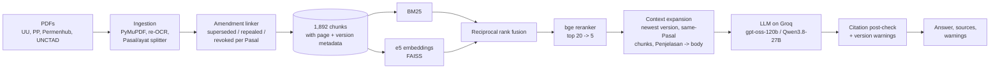

# Maritime Regulation RAG

A question-answering assistant for **Indonesian maritime and logistics regulations** (UU, PP,
Permenhub) and the **UNCTAD Review of Maritime Transport 2025**. It answers only from those
documents, cites every claim down to the **document, Pasal/ayat and page**, knows which provisions
were **amended or repealed** by later regulations, and says *"not found"* instead of guessing.

Built end to end as an AI-engineering portfolio project: PDF ingestion and OCR repair,
hybrid retrieval with a reranker, grounded generation with a citation verifier, a
pre-registered evaluation with human-validated LLM judges, and a web demo with a JSON API.

> Not legal advice. Public documents only; the system is a research prototype.


## Headline results

From the Phase 4 evaluation on a frozen set of 54 questions (44 answerable, 10 out of scope);
every number is in [`reports/eval.json`](reports/eval.json), the full report is
[`reports/eval.md`](reports/eval.md).

1. **Retrieval**: hybrid BM25 + e5 with bge-reranker reaches **Hit@5 0.89** (95% CI 0.80-0.98)
   and MRR@10 0.75, selected among 5 retrievers by a rule fixed before the run.
2. **Grounding**: all **218 of 218 citations** in the answers of both LLMs map to a provided
   source; both LLMs refuse **10/10** out-of-scope questions, with **0 false refusals** on 44
   answerable questions.
3. **Correctness** (cross-judged LLMs, validated by hand on 20 answers, Cohen's kappa 0.87):
   Qwen3.8-27B **40/44 (91%)**, gpt-oss-120b 33/44 (75%).
4. **Amended regulations**: the current version is cited in 7/8 amended-provision answers by
   each LLM; 41/44 and 39/44 answers are fully supported by their cited sources (kappa 1.00).
5. **Cost and speed**: about **$0.27** for all 202 LLM calls of the evaluation (Groq); median
   generation 0.7-1.1 s; retrieval and reranking run locally on a laptop GPU.

## Example

> **Q:** Who grants the clearance a ship needs before leaving an Indonesian port, and when does
> that clearance lapse?
>
> - The **Syahbandar** (port authority) issues the clearance required for a ship to depart an
>   Indonesian port – the Surat Persetujuan Berlayar [UU 17/2008, Pasal 219, p. 90].
> - That clearance becomes invalid if the ship does not set sail within **24 hours** after the
>   approval is given [UU 17/2008, Pasal 219, p. 90].
>
> ⚠ UU 17/2008 may have been amended by UU 11/2020, UU 6/2023, which are not in the corpus;
> check the cited Pasal against them.

The question is in English, the law is in Indonesian. The page number is the physical PDF page,
so the citation opens at the right place. The warning is added by the system, not the model.

When a provision has been amended, the model is given **both versions, labelled**. For "which
cargo may a tramp ship carry?" the context included:

| source | status |
|---|---|
| PM 23/2022 Pasal 17 (new wording) | CURRENT |
| PM 93/2013 Pasal 17 (original) | SUPERSEDED by PM 23/2022 |
| PM 23/2022: "Pasal 18 dihapus" | CURRENT |
| PM 93/2013 Pasal 18 (original) | REPEALED by PM 23/2022 |

The answer lists the four cargo types of the current Pasal 17, including "barang umum" (general
cargo), which the 2013 original did not allow.

## Why this is harder than a generic RAG

- **Regulations are amended without a consolidated text.** PM 93/2013 was changed by PM 74/2016
  and PM 23/2022; UU 17/2008 by UU 66/2024 (69 Pasal changed, inserted or repealed). Retrieval can easily return the outdated
  wording. Here, every amending clause is parsed and linked to the Pasal it changes, and answers
  are built from the newest version.
- **Revocations are buried in closing provisions.** PP 31/2021 Pasal 233 revokes 123 specific
  Pasal of two older regulations; those are parsed and labelled REPEALED.
- **Citations must be checkable.** A post-check maps every citation to the exact chunk and page
  given to the model; an answer with no valid citation is replaced by "not found".
- **Messy sources.** Scanned PDFs with a poor OCR layer (re-OCR with Tesseract and a quality
  metric), Pasal/ayat structure parsed from layout text, separate Penjelasan (elucidation) files.
- **Two languages.** Questions in English or Indonesian over Indonesian legal text
  (multilingual e5 embeddings and reranker).

## How it works



| stage | what it does | code |
|---|---|---|
| Ingestion | parses PDFs page by page, re-OCRs bad scans, splits text into Pasal (long ones by ayat), keeps physical page numbers | `maritime_rag/ingest.py`, `pasal_splitter.py`, `ocr.py` |
| Amendments | links each amending clause ("Ketentuan Pasal 71 diubah ...", "Pasal 18 dihapus", inserted Pasal) to the Pasal it changes; per-Pasal revocation lists | `amendments.py`, `revocations.py` |
| Retrieval | BM25 (with a "doc > BAB > Pasal" heading prefix) and multilingual-e5-base in FAISS, fused with RRF, reranked with bge-reranker-v2-m3 | `retrieval/` |
| Context | adds the newest version of a superseded Pasal, the other chunks of a split Pasal, and the body of a Penjelasan hit, within a token budget | `answer/versions.py` |
| Generation | one prompt with numbered, status-labelled sources; answer in the question's language; provider interface for Groq, Gemini, OpenAI, Anthropic and Ollama | `answer/prompt.py`, `answer/providers.py` |
| Post-check | parses and validates citations (incl. unbracketed and page-less ones), adds warnings, refuses when nothing valid remains | `answer/citations.py`, `answer/pipeline.py` |
| Evaluation | question set tooling, retrieval metrics with bootstrap CIs, cached answer runs, cross-judging, manual-label agreement, report and figures | `eval/` |
| Demo | FastAPI JSON API + Gradio UI in one server | `demo/` |

## Corpus

Fourteen public documents, listed with their official source URLs in
[`data/manifest.csv`](data/manifest.csv) (the PDFs themselves are not committed).

| document | title | status in the corpus |
|---|---|---|
| UU 17/2008 | Pelayaran (Shipping Act) | amended by UU 66/2024 |
| UU 66/2024 | third amendment of UU 17/2008 | in force |
| PP 31/2021 | Penyelenggaraan Bidang Pelayaran | in force; revokes parts of PP 20/2010 and PP 61/2009 |
| PP 20/2010 | Angkutan di Perairan | partly revoked |
| PP 61/2009 | Kepelabuhanan | partly revoked |
| PM 93/2013 | Penyelenggaraan dan Pengusahaan Angkutan Laut | amended by PM 74/2016 and PM 23/2022 |
| PM 74/2016, PM 23/2022 | amendments of PM 93/2013 | in force |
| PM 59/2021 | Usaha Jasa Terkait dengan Angkutan di Perairan | amended by PM 3/2026 |
| PM 3/2026 | amendment of PM 59/2021 | in force |
| PM 50/2021 | Penyelenggaraan Pelabuhan Laut | in force |
| PM 72/2017 | Tarif Jasa Kepelabuhanan | in force |
| PM 5/2024 | Kewajiban Pelayanan Publik Angkutan Barang di Laut (tol laut) | in force |
| UNCTAD RMT 2025 | Review of Maritime Transport 2025: Overview | report |

UU 17/2008 was also amended by the Cipta Kerja laws (UU 11/2020, UU 6/2023), which are not in the
corpus; every answer citing UU 17/2008 carries a warning about that.

## Evaluation

The evaluation plan ([`docs/eval_plan.md`](docs/eval_plan.md)) was written **before any result**:
metrics, slices, the retriever selection rule and the judge-validation rule are fixed, and every
change made after seeing results is logged as a post-hoc change.

- **Question set**: 54 questions drafted from specific chunks and reviewed by hand: factual (24),
  "which Pasal regulates X" (7), amended provisions (8), English (5), out of scope (10). Gold
  labels are chunk ids; the set was frozen before the first run.
- **Retrieval**: 5 configurations compared with Hit@1, Hit@5 and MRR@10 and 95% bootstrap CIs;
  hybrid + reranker was selected by the pre-registered rule.
- **Answers**: two LLMs on identical, cached contexts; refusal accuracy, false refusals, citation
  validity, truncation, latency and cost. Two bugs found in the first run were fixed, and both the
  as-run and the fixed numbers are reported.
- **LLM-as-judge**: each LLM's answers are graded by the other (no self-grading) for correctness,
  faithfulness to the cited sources, and whether a relevant superseded source is mentioned. The
  judges were validated against 20 blind manual labels (agreement 95% / 100% / 75%, kappa 0.87 /
  1.00 / 0.47 for the three criteria).


**Known limitations** (details in [`reports/eval.md`](reports/eval.md)): small n (CIs of about
+/-0.15); questions drafted by the system's author and labelled by one annotator; the judges are
the two compared models; the "superseded source mentioned" criterion is only just above the
agreement rule and its rubric needs a sharper definition; when the right Pasal is not retrieved,
the LLMs tend to answer from a neighbouring Pasal instead of refusing.

## Demo

```bash
uv run maritime-demo
```

Open <http://127.0.0.1:7860>: ask a question, choose the LLM and the reranker, and see the
answer, the warnings, every source given to the model with its version status, and the latency,
tokens and estimated cost. Any source can be opened in full. The *Evaluation* tab shows the
headline results.

The same server exposes a JSON API (interactive docs at `/docs`):

```bash
curl -X POST http://127.0.0.1:7860/ask -H "Content-Type: application/json" \
     -d '{"question": "Apa saja jenis tarif jasa kepelabuhanan untuk pelayanan jasa kapal?", "llm": "groq"}'
```

`GET /sources/{chunk_id}` returns one source in full. Errors are explicit: 422 for an invalid
question, 503 when the LLM provider fails (no silent fallback). The server binds to 127.0.0.1 and
has no authentication.

## Quickstart

Requirements: Python 3.11, [uv](https://docs.astral.sh/uv/), a Groq API key. A CUDA GPU is
optional (e5 and the reranker run on CPU too, more slowly). Tesseract is only needed to re-run OCR.

```bash
uv sync
echo GROQ_API_KEY=your-key > .env   # gitignored; read by every command
```

1. **Data**: download each PDF listed in `data/manifest.csv` into `data/raw/` under the name in
   its `file` column, e.g.

   ```bash
   curl -L -o data/raw/uu_17_2008.pdf "https://peraturan.bpk.go.id/Download/28451/UU%20Nomor%2017%20Tahun%202008.pdf"
   ```

   The UNCTAD entry points to the report page; save the *Overview* PDF as
   `data/raw/unctad_rmt_2025.pdf`. `reports/validation.md` records the SHA-256 of every file used.

2. **Build**:

   ```bash
   uv run maritime-ingest          # PDFs -> data/processed/chunks.jsonl (+ reports/ingest_stats.md)
   uv run maritime-index           # e5 embeddings -> FAISS index
   ```

3. **Ask**:

   ```bash
   uv run maritime-ask "Apa persyaratan untuk memperoleh izin usaha perusahaan angkutan laut?"
   uv run maritime-ask "Can a foreign-flagged ship carry cargo between Indonesian domestic ports?" --llm groq-qwen
   uv run maritime-search "izin usaha angkutan laut" --retriever hybrid --rerank   # retrieval only
   ```

4. **Demo**: `uv run maritime-demo`.

5. **Tests**: `uv run pytest` (fast tests use fakes; tests that need the built index skip
   themselves when it is missing).

<details>
<summary>Re-running OCR and the evaluation</summary>

OCR needs Tesseract 5 and two resources in the gitignored `.cache/`:

```bash
# Tesseract 5 (Windows: winget install UB-Mannheim.TesseractOCR); path in configs/ingest.yaml -> ocr.tesseract_cmd
mkdir -p .cache/tessdata .cache/wordlists
curl -L -o .cache/tessdata/ind.traineddata https://github.com/tesseract-ocr/tessdata_best/raw/main/ind.traineddata
cp -r "<tesseract install dir>/tessdata/configs" "<tesseract install dir>/tessdata/pdf.ttf" .cache/tessdata/
curl -L -o .cache/wordlists/00-indonesian-wordlist.lst https://raw.githubusercontent.com/geovedi/indonesian-wordlist/master/00-indonesian-wordlist.lst
uv run maritime-ocr-quality
```

Evaluation (the committed caches make the answer and judge steps resumable and cheap to re-run):

```bash
uv run maritime-eval-retrieval                       # Step 2, local
uv run maritime-eval-answers contexts                # Step 3: shared contexts, local
uv run maritime-eval-answers run --llm groq          # cached per question; resumes after quota errors
uv run maritime-eval-answers run --llm groq-qwen
uv run maritime-eval-answers report
uv run maritime-eval-judge run --judge groq          # Step 4: each LLM grades the other
uv run maritime-eval-judge run --judge groq-qwen
uv run maritime-eval-judge report
uv run maritime-eval-report                          # Step 5: reports/eval.md, eval.json, figures
```

</details>

## Configuration

Every setting lives in `configs/*.yaml`: ingestion and OCR (`ingest.yaml`), retrieval
(`retrieval.yaml`), answering, prompt and LLM profiles (`answer.yaml`), evaluation (`eval.yaml`)
and the demo (`demo.yaml`).

LLMs are named profiles in `configs/answer.yaml`, selected with `--llm`:

| profile | model | notes |
|---|---|---|
| `groq` (default) | openai/gpt-oss-120b | `GROQ_API_KEY` |
| `groq-qwen` | qwen/qwen3.8-27b | same key; preview model |
| `gemini` | gemini-3.8-flash | `GEMINI_API_KEY`; slow on the free tier |
| `openai`, `anthropic` | configurable | `OPENAI_API_KEY`, `ANTHROPIC_API_KEY` |
| `ollama` | qwen2.5:7b-instruct (local) | only with `--llm ollama --allow-local` |

Before any model loads, the configured model id is checked against the provider's model list and
a 5-token probe is sent. HTTP 429/503 are retried with backoff (honouring Retry-After), calls are
paced to the provider's token-per-minute limit, and every call is logged with its tokens, latency
and estimated cost (`logs/llm_calls.jsonl`). Nothing falls back silently to another model.

## Project structure

```
configs/            all settings (ingest, retrieval, answer, eval, demo)
data/manifest.csv   the 14 source documents and their URLs
data/eval/          question set (draft, review workbook, frozen gold), caches, manual labels
docs/               roadmap and the pre-registered evaluation plan
reports/            ingestion stats, OCR quality, retrieval smoke checks, evaluation reports, figures
src/maritime_rag/
  ingest.py, pasal_splitter.py, ocr.py, amendments.py, revocations.py   Phase 1: ingestion
  retrieval/        Phase 2: BM25, e5 + FAISS, hybrid RRF, reranker
  answer/           Phase 3: providers, prompt, context expansion, citations, pipeline, CLI
  eval/             Phase 4: questions, retrieval/answer evaluation, judge, report, figures
  demo/             Phase 5: FastAPI API + Gradio UI
tests/              pytest suite (fakes for models and LLMs)
```

## Project phases

| phase | what | outputs |
|---|---|---|
| 1. Ingestion | PDF parsing, re-OCR, Pasal/ayat chunking, amendment links | [`reports/ingest_stats.md`](reports/ingest_stats.md), [`reports/ocr_quality.md`](reports/ocr_quality.md) |
| 2. Retrieval | BM25, dense e5 + FAISS, hybrid RRF, bge reranker | [`reports/retrieval_smoke_rerank.md`](reports/retrieval_smoke_rerank.md) |
| 3. Answering | providers, version-aware context, citation post-check, LLM comparison | [`reports/llm_comparison_phase3.md`](reports/llm_comparison_phase3.md) |
| 4. Evaluation | pre-registered plan, gold set, retrieval and answer metrics, validated LLM judges | [`reports/eval.md`](reports/eval.md) |
| 5. Demo | Gradio UI and FastAPI JSON API | `uv run maritime-demo` |

## Tech stack

Python 3.11 · uv · PyMuPDF · Tesseract · rank_bm25 · sentence-transformers
(intfloat/multilingual-e5-base, BAAI/bge-reranker-v2-m3) · FAISS · PyTorch (CUDA) · Groq
(gpt-oss-120b, Qwen3.8-27B) behind a provider interface (also Gemini, OpenAI, Anthropic, Ollama) ·
FastAPI · Gradio · pytest.

## Data and license notes

The source documents are public Indonesian regulations (peraturan.go.id, peraturan.bpk.go.id)
and the UNCTAD Review of Maritime Transport 2025 Overview; they are not redistributed here, only
listed with their official URLs. Answers are generated from those texts and are **not legal
advice**: check the official text of any cited regulation.
