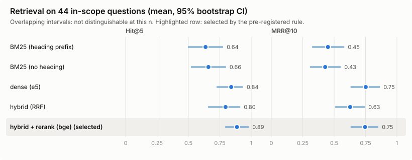
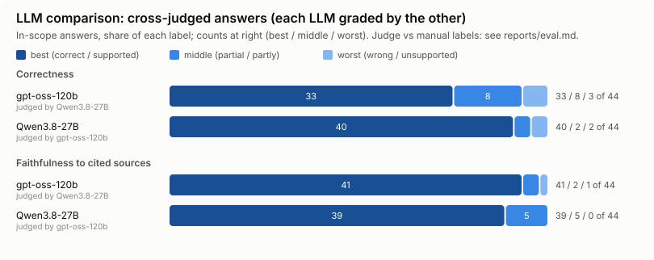

# Evaluation report (Phase 4)

Generated 2026-10-14T17:22. Plan and rules: `docs/eval_plan.md` (fixed before results; post-hoc changes listed below). Every number here is in `reports/eval.json`.

## Headline results

1. Retrieval: hybrid BM25 + e5 with bge-reranker reaches Hit@5 0.89 (95% CI 0.80-0.98) and MRR@10 0.75 on 44 in-scope questions, selected among 5 retrievers by a rule fixed before the run.
2. Grounding: all 218 of 218 citations in the answers of both LLMs map to a provided source; gpt-oss-120b refuses 10/10 and Qwen3.8-27B refuses 10/10 out-of-scope questions, with 0 false refusals on 44 in-scope questions each.
3. Correctness (cross-judged; judge vs human agreement kappa 0.87, n = 20): Qwen3.8-27B 40/44 (91%) correct, gpt-oss-120b 33/44 (75%).
4. Amended regulations: the current version is cited in 7/8 (gpt-oss-120b), 7/8 (Qwen3.8-27B) amended-Pasal answers; every statement is supported by the cited sources in 41/44 (gpt-oss-120b), 39/44 (Qwen3.8-27B) answers (judge vs human kappa 1.00).
5. Cost and speed: about $0.27 for all 202 LLM calls of the evaluation (answers and judging, Groq); median generation 1.1 s (gpt-oss-120b) / 0.7 s (Qwen3.8-27B); retrieval and reranking run locally.

Each line's values and their `eval.json` paths: `headline[i].values`.

## 1. Retrieval (Step 2)

44 in-scope questions (frozen gold, sha256 `046a3c591e3f`). Mean with 95% bootstrap CI; top 10 per configuration, no answer-time expansion.

| configuration | Hit@1 | Hit@5 | MRR@10 | time (s) |
|---|---|---|---|---|
| BM25 (heading prefix) | 0.341 [0.20, 0.48] | 0.636 [0.50, 0.77] | 0.451 [0.33, 0.58] | 0.2 |
| BM25 (no heading) | 0.318 [0.18, 0.45] | 0.659 [0.52, 0.80] | 0.429 [0.31, 0.55] | 0.1 |
| dense (e5) | 0.705 [0.57, 0.84] | 0.841 [0.73, 0.93] | 0.752 [0.63, 0.86] | 15.8 |
| hybrid (RRF) | 0.500 [0.36, 0.64] | 0.795 [0.66, 0.91] | 0.628 [0.51, 0.74] | 1.5 |
| hybrid + rerank (bge) **(selected)** | 0.659 [0.52, 0.80] | 0.886 [0.80, 0.98] | 0.746 [0.63, 0.85] | 24.6 |

Selection: best Hit@5 = 0.886; within 0.02 of it: hybrid_rerank; simplest: hybrid_rerank (simplicity order {'bm25': 0, 'bm25_noheading': 0, 'dense': 1, 'hybrid': 2, 'hybrid_rerank': 3}; BM25 tie keeps the heading; then MRR). The CIs of the top configurations overlap: the choice follows the rule, not a demonstrated difference.

## 2. Score gate (proposal; stayed off)

Rule: largest candidate refusing at most 1 in-scope question(s) (top-1 bge-reranker score).

| threshold | in-scope refused | out-of-scope refused |
|---|---|---|
| 0.005 | 0 | 4/10 |
| 0.01 | 0 | 4/10 |
| 0.02 | 2 | 5/10 |
| 0.05 | 2 | 8/10 |
| 0.1 | 3 | 10/10 |

Proposed threshold: **0.01**. Applied to the Step 3 contexts it would have refused 4 out-of-scope questions before the LLM (O01, O04, O05, O06) and 0 in-scope (-). Both LLMs already refused all out-of-scope questions, so the gate would only save LLM calls. English (cross-lingual) questions score low (about 0.014), close to some out-of-scope ones: a single threshold cannot separate them.

## 3. Answers (Step 3): as-run vs fixed

Fixed = after post-hoc change 3 (two bug fixes). Both LLMs answer from the same stored context per question.

| metric | gpt-oss-120b as-run | gpt-oss-120b fixed | Qwen3.8-27B as-run | Qwen3.8-27B fixed |
|---|---|---|---|---|
| out-of-scope refused | 10/10 (100%) | 10/10 (100%) | 10/10 (100%) | 10/10 (100%) |
| in-scope refused (false refusals) | 0/44 (0%) | 0/44 (0%) | 0/44 (0%) | 0/44 (0%) |
| truncated | 0 | 0 | 0 | 0 |
| citations valid / parsed | 83/83 | 82/82 | 133/133 | 136/136 |
| gold chunk in context | 39/44 (89%) | 40/44 (91%) | 39/44 (89%) | 40/44 (91%) |
| amended: cites current version | 7/8 | 7/8 | 7/8 | 7/8 |
| Cipta Kerja warning when UU 17/2008 cited | 10/10 (100%) | 10/10 (100%) | 12/12 (100%) | 13/13 (100%) |

- gpt-oss-120b: 3 changed question(s): F01 (context: bug 1; gold in context True -> True); F05 (context: bug 1; gold in context False -> True); A07 (context: bug 1; gold in context True -> True)
- Qwen3.8-27B: 4 changed question(s): F01 (context: bug 1; gold in context True -> True); F05 (context: bug 1; gold in context False -> True); F10 (post-check: bug 2; gold in context True -> True); A07 (context: bug 1; gold in context True -> True)

Details: `reports/eval_answers.md`.

## 4. LLM comparison (Step 4)

Cross-judging: each LLM's fixed in-scope answers are graded by the other LLM, which sees only the question, gold text, reference answer, the cited sources and the answer. Validated by one annotator on a blind, stratified sample of 20 answers (10 per LLM).

| criterion | gpt-oss-120b (judge, n=44) | Qwen3.8-27B (judge, n=44) | gpt-oss-120b (manual, n=10) | Qwen3.8-27B (manual, n=10) | agreement | kappa |
|---|---|---|---|---|---|---|
| correctness | correct 33, partial 8, wrong 3 (n=44) | correct 40, partial 2, wrong 2 (n=44) | correct 7, partial 2, wrong 1 (n=10) | correct 9, wrong 1 (n=10) | 95% | 0.87 |
| faithfulness | supported 41, partly 2, unsupported 1 (n=44) | supported 39, partly 5, unsupported 0 (n=44) | supported 9, partly 1 (n=10) | supported 8, partly 2 (n=10) | 100% | 1.00 |
| superseded_mentioned ⚠ | yes 4, no 7, n.a. 33 (n=44) | yes 10, no 9, n.a. 25 (n=44) | n.a. 8, yes 2 (n=10) | n.a. 8, yes 1, no 1 (n=10) | 75% | 0.47 |

All three criteria meet the plan's rule (kappa >= 0.4), so the judge labels are used. ⚠ **superseded_mentioned is flagged**: kappa 0.47 is just above the rule with n = 20, and most disagreements were the annotator saying "n.a." where the judge saw a relevant superseded or repealed source: the rubric's "relevant" is ambiguous. Kept as is (not relabelled); see limitations and future work.

Each LLM was graded by a different judge; the high agreement of both judges with the manual labels is what makes the two columns comparable.

## 5. Per slice

| slice | retrieval Hit@5 (selected) | gpt-oss-120b correct (judge) | Qwen3.8-27B correct (judge) |
|---|---|---|---|
| factual_id (n=24) | 0.88 | 18/24 | 22/24 |
| which_pasal (n=7) | 1.00 | 7/7 | 6/7 |
| amended (n=8) | 0.88 | 3/8 | 7/8 |
| english (n=5) | 0.80 | 5/5 | 5/5 |

Correctness by whether the gold chunk was in the context: gpt-oss-120b: gold in context correct 31, partial 8, wrong 1 (n=40), gold not in context correct 2, partial 0, wrong 2 (n=4); Qwen3.8-27B: gold in context correct 38, partial 2, wrong 0 (n=40), gold not in context correct 2, partial 0, wrong 2 (n=4)

## 6. Cost and latency

| | gpt-oss-120b | Qwen3.8-27B |
|---|---|---|
| answer calls (as-run + re-asked) | 57 | 57 |
| answer cost (USD) | 0.0312 | 0.1680 |
| judge calls made by this model | 44 | 44 |
| judge cost (USD) | 0.0143 | 0.0558 |
| median / p90 generation (s) | 1.1 / 4.0 | 0.7 / 1.3 |

Total: about **$0.269** for 202 LLM calls (estimated from token counts and Groq list prices; startup probes excluded). Retrieval and reranking run locally.

## 7. Post-hoc changes

Full text: `docs/eval_plan.md`, "Post-hoc changes".

1. *after the retrieval results, before any answer result*: Answer-time Penjelasan -> body expansion (motivated by E03): a Penjelasan chunk in the context brings in the body of its Pasal, within the same token budget. Retrieval metrics unchanged.
2. *after the retrieval results, before any answer result*: The judge sees only the cited sources (not the full context); faithfulness is judged against the cited sources.
3. *after the Step 3 answer results, before any judge result*: Two bug fixes, reported as-run and fixed: (bug 1) the same-Pasal budget dropped retrieved hits even when that could not make room (F01, F05, A07; F05 lost its gold); (bug 2) a bracketed prose note was rewritten as a citation (Qwen F10). Only changed contexts were re-asked; the post-check was re-applied without LLM calls.

## 8. Findings

**Questionable gold (frozen; reported, not re-scored)**

- **F07**: Gold is PP 31/2021 Pasal 73 only. UU 17/2008 Pasal 104 states the same conditions for building a special terminal, and both LLMs answered from it (Qwen also cited the revoked PP 61/2009 Pasal 111 and said it was revoked). A legally sound answer that misses the gold chunk.
- **F13**: The same list of special goods (kayu gelondongan, barang curah, rel, ternak) is in PM 93/2013 Pasal 96 (retrieved at rank 1), UU 17/2008 Pasal 45 and PP 31/2021 Pasal 23, not only in the gold PP 20/2010 Pasal 185.
- **A01**: UU 17/2008 Pasal 28 ayat (1) also answers who grants the licence (the Minister, for inter-provincial routes; retrieved at rank 4). The amended-slice target, PM 74/2016 Pasal 71 (application to the Head of BKPM), is not in the context, so the amendment is not tested.

**System weaknesses**

- **F24**: Answering from a neighbouring Pasal instead of refusing: the gold (PM 5/2024 Pasal 10, the operator's obligations) is not in the context, and both LLMs present PM 5/2024 Pasal 4 (the programme's principles) as the operator's obligations. Faithful to what they cite, but it answers a different question.
- **F05**: Same pattern in the as-run answers: the gold UU 17/2008 Pasal 224 had been dropped from the context (bug 1), and both LLMs answered with the crew-recruitment requirements of PM 59/2021 Pasal 99. After the fix the gold is back in the context, both LLMs cite it, and both fixed answers are judged correct.

## 9. Limitations

- Small n: 44 in-scope and 10 out-of-scope questions. A proportion's 95% CI spans about +/-0.15; per-slice results (n = 5-24) are indicative only.
- Questions were drafted by the system's author (an LLM) from specific chunks and reviewed by one person; even paraphrased, they favour retrievable wording.
- The judges are the two compared models (cross-judged, no model grades itself), validated by one annotator on 20 answers.
- superseded_mentioned is flagged: kappa 0.47 is just above the 0.40 rule with n = 20, and 4 of its 5 disagreements were the annotator saying "n.a." where the judge saw a relevant superseded or repealed source. The rubric does not define "relevant" precisely (e.g. whether a revoked older provision among the cited sources counts). Result kept, not relabelled; rubric fix listed as future work.
- Three gold items are questionable (F07, F13, A01: another provision answers the question too); the frozen gold was not changed.
- Post-hoc changes 1-3 were decided after some results (listed above); Step 3 is reported both as-run and fixed.
- The corpus has no consolidated text and lacks the Cipta Kerja amendments (UU 11/2020, UU 6/2023) to UU 17/2008; answers citing UU 17/2008 carry a warning instead.
- Groq outputs are not fully deterministic; fp16 retrieval can swap near-tied hits. Cost is estimated from token counts and the listed prices (reasoning tokens assumed billed as output; Qwen does not report them separately).

## 10. Future work

- Rubric: define "relevant superseded source" for superseded_mentioned (e.g. relevant = a gold chunk, or a cited chunk on the same Pasal, is SUPERSEDED/REPEALED) and re-validate with a fresh manual sample.
- Retrieval: handle REPEALED / revoked chunks at retrieval time (F07: the revoked PP 61/2009 Pasal 111 outranks the current PP 31/2021 Pasal 73).
- Refusal when the right Pasal is missing: both LLMs answer from a neighbouring Pasal instead of saying "not found" (F24); half of the answers without the gold in context were judged wrong.
- A larger, independently written question set and a second annotator.
